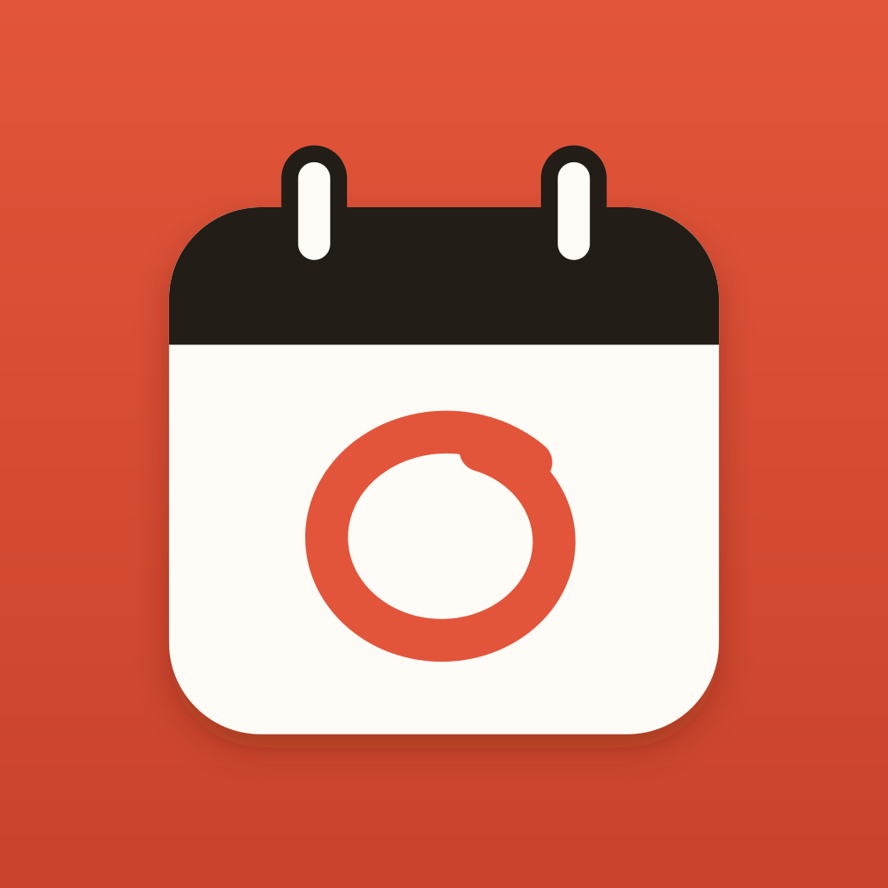
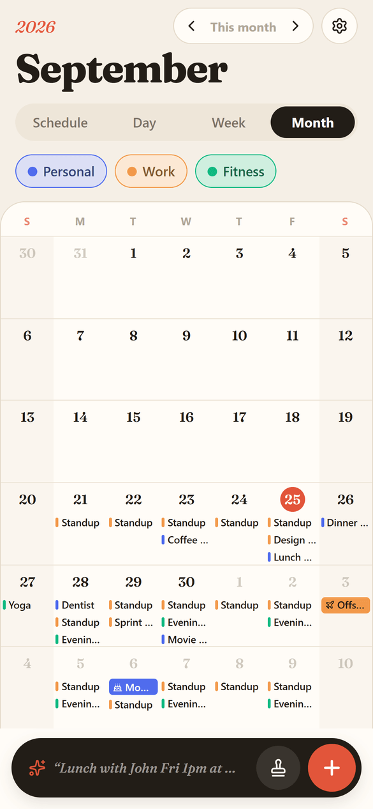
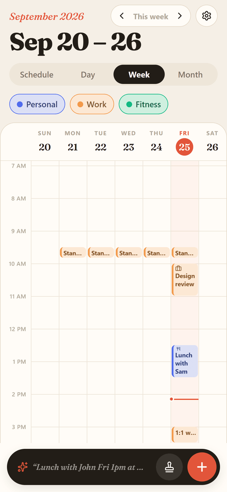
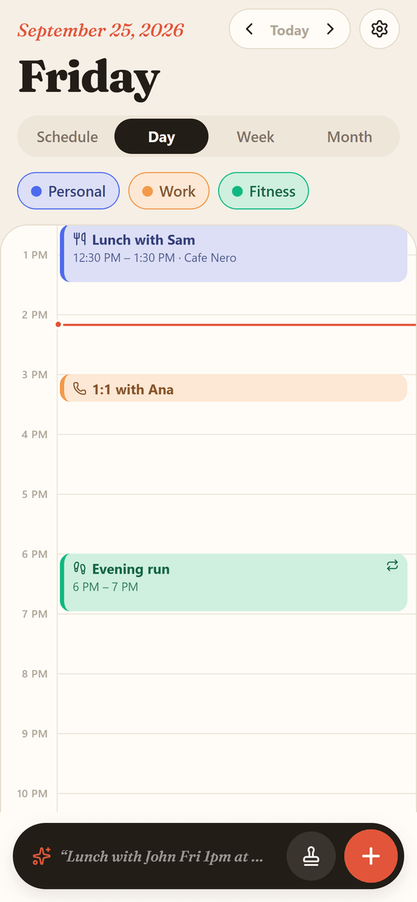
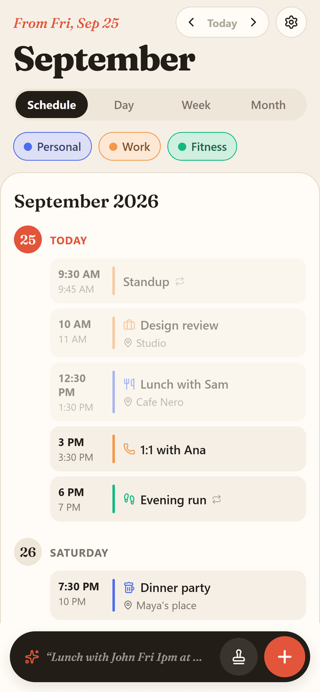
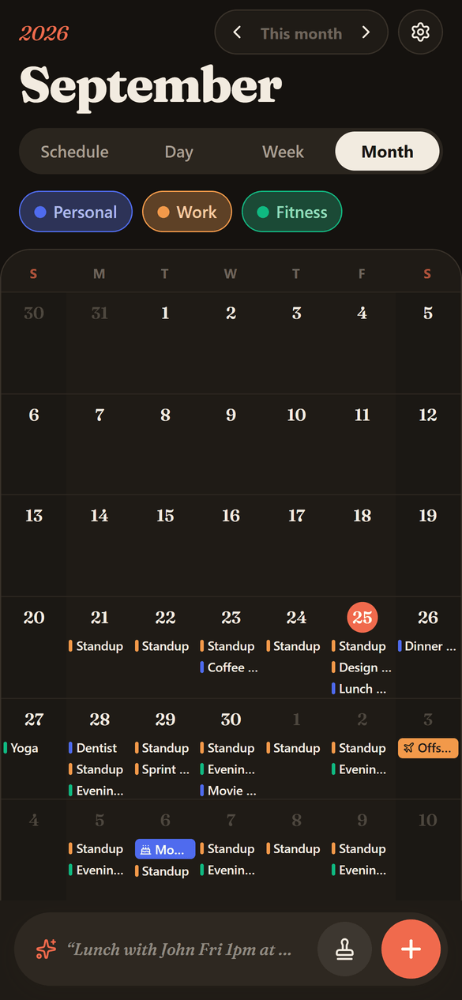
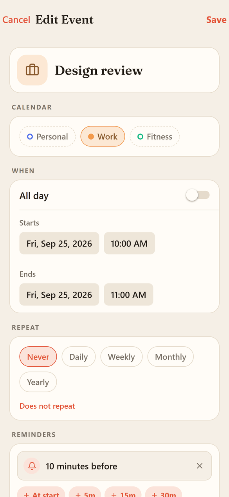

<p align="center">
  
</p>

<h1 align="center">OpenCal</h1>

<p align="center">
  A local-first calendar for Android (and iOS/web) built with Expo, with things most calendars don't do:<br/>
  pause a repeat, schedule quiet time like an event, drop a stamp on a slot,<br/>
  and let an AI assistant manage your schedule through a sync server you run yourself.<br/>
  No accounts, no ads, no Google services.
</p>

<p align="center">
  <a href="https://github.com/BoazCohenJ/OpenCal/releases/latest"><b>Download the latest Android APK</b></a>
</p>

<p align="center">
  <b>The 45-second tour</b> (sound on): Quick Add, stamps, pausing a repeat, scheduled Do Not Disturb,<br/>
  reminders to the minute, calendar defaults and custom colors, all real footage from the app.
</p>

https://github.com/user-attachments/assets/96c68291-76bc-4ca8-a030-11c235435344

<p align="center">
  
  
  
  
</p>
<p align="center">
  
  
</p>

## What makes OpenCal different

The things OpenCal does that most calendars don't:

- **Your own sync server, with an AI assistant on top.** Run the small [OpenCal server](server/README.md) at home (one Docker command, great with Tailscale), enter its address and key in Settings → Sync, and every phone stays in step: calendars, events, stamps, birthdays and color rules. The same server offers calendar tools over MCP, so an assistant like Claude, ChatGPT or Hermes can read your schedule and add, move or delete events ("only this one" for repeats included). Forward it a message and the events appear on your phone, and every change it makes can be undone. Entirely optional, and your calendar only ever leaves the phone for your own server.
- **Pause a repeat.** Skip a date range (a holiday, a school break) for one repeating event or a whole calendar, and it resumes on its own. No deleting and re-creating the series.
- **Quiet time and Do Not Disturb, scheduled like events.** Add "every Monday 17:00–18:00" and reminders arrive silently (quiet) or are skipped (DND) for that window.
- **Stamps.** Save the events you repeat by hand (coffee, gym, calls) and drop one on any empty time slot by tapping the time, then the stamp, with Undo.
- **Tap an empty time, get an event.** A see-through event appears where you tapped; drag it to move it (sideways to another day in Week view), drag its round handles to change the length, tap Done for the full editor. On a computer, a small panel asks for the title, location and calendar first.
- **Floating or fixed time.** A floating event keeps its clock time in any time zone (a 9:00 run stays at 9:00 when you travel); a fixed one keeps the same moment and remembers its time zone, so a repeating 9:00 meeting stays at 9:00 there across daylight-saving changes. Set the default for new events in Settings and change it on any event. This follows the iCalendar / JSCalendar (RFC 8984) model.
- **Color rules.** Color every event whose title contains a word (all your "Break" events amber, all "Gym" green) in Settings → Color rules, instead of coloring each one by hand.
- **Quick Add that understands a sentence.** Type "Lunch with John Fri 1pm at Cafe X" and review the parsed event before saving.
- **Share events both ways.** Send any event as an `.ics` invite every calendar app understands, and open invites, calendar files, invitation emails (including Google Calendar's "share event" emails, which have no `.ics`) or a plain shared message straight in OpenCal. A plain message goes through Quick Add, which finds the date and time in it; opening an updated invite updates the same event.
- **Home-screen widgets that stay current.** Schedule, Today, Week and Month widgets follow the app's colors and light/dark theme, page back and forward right on the home screen, resize freely, and roll over to the new day at midnight on their own (a native alarm redraws them).
- **No Google services, anywhere.** Reminders are scheduled on the device with a small local module, not Firebase or Google Play services. The F-Droid variant also contains no remote-code library and never loads code from the network. No account, no ads, no tracking.

## Also included

- **Four views:** Schedule (agenda), Day, Week and Month, with swipe navigation and a header that says where you are ("Tomorrow", "In 3 weeks"). The View button also shows or hides each calendar.
- **Reminders down to the minute,** with presets and custom values; all-day reminders fire at a time you choose.
- **Calendars with defaults:** a color plus default reminders, repeat, location and tags that new events inherit.
- **Multi-select in Day and Week view:** long-press events, then drag them together or nudge by 15 minutes / 1 hour / 1 day. Delete a selection at once, with Undo; for repeating events it asks whether to delete only that occurrence, it and the following ones, or the whole series.
- **Multi-day events** as one long bar across the days they cover, and **birthdays** that show up every year as "Dana's 36th birthday".
- **Colors:** 20 named swatches, a color wheel, hex input and your own saved colors. **Icons** (or any emoji) for events and stamps, and **dark mode** (System / Light / Dark).
- **A desktop layout in the browser:** in a wide window the web app gets a sidebar, a toolbar, editors as dialogs and keyboard shortcuts (T today, arrows to move, D/W/M/S views, C new event, Q quick add). Narrow windows keep the phone layout.
- **Import & export:** back up everything to one file and restore or merge it on another phone, or move events to and from Google Calendar, Apple Calendar and Outlook with standard `.ics` files. Import preserves explicit UTC schedules and additional RDATE dates; sub-daily recurrence rules (hourly, minutely, secondly) are skipped and counted in the import summary.
- **Settings with explanations:** default length and calendar for new events, and (i) buttons that explain the trickier settings in place.

## Install on Android

1. Open the [latest release](https://github.com/BoazCohenJ/OpenCal/releases/latest) on your phone and download the `.apk`.
2. Open it and allow installing from your browser when Android asks.
3. The app updates itself over the air: when a new version is published it shows "A new version of OpenCal is ready" with a Restart button.

Releases that change native parts of the app (icons, splash, new native modules) need a new APK from the Releases page; everything else arrives automatically.

### Install with Obtainium (no over-the-air updates)

Releases also carry a `-fdroid` APK: the F-Droid variant (`com.boazcohen.opencal`) with no remote code loading. It is a different app id from the build above, so it installs next to it instead of updating it; move your data over with Import & export. In [Obtainium](https://github.com/ImranR98/Obtainium), add `https://github.com/BoazCohenJ/OpenCal` and set the APK filter to `fdroid`. Obtainium then follows new releases and offers each update.

## Development

Requirements: Node 22+ and npm.

```bash
npm install
npx expo start          # press "w" for web, or scan the QR code with Expo Go
npm run typecheck      # typecheck (includes the Node stack allowance)
npx expo lint           # lint
```

Calendar, sync and import regressions can be checked without opening the app using `npm run test:regressions` (requires Node 24+).

Build an installable Android APK in the cloud with [EAS](https://docs.expo.dev/eas/). Release builds remove unused code and resources with R8 and resource shrinking:

```bash
# Release build: ARM64 devices only; same app ID and preview updates as the installed preview app.
npx eas-cli@latest build -p android --profile preview-arm64

# Universal APK (ARM and x86, including emulators); not attached to releases, build it only when needed.
npx eas-cli@latest build -p android --profile preview
```

Each GitHub release attaches two APKs: `OpenCal-X.Y.Z-arm64.apk` (the OTA build) and `OpenCal-X.Y.Z-fdroid-arm64.apk` (the F-Droid variant, with a clean app ID and no update library). Both have the same version and signing credentials per variant. Use the universal profile for devices without ARM64 support. The production AAB and F-Droid recipe builds retain support for all default architectures. These build changes require installing a new APK; they cannot reduce an already installed app through an over-the-air update.

`.easignore` excludes generated native folders, local validation builds, QA reports, server files and promo tooling from cloud build uploads. App assets and local native modules remain included.

Every push to `main` runs the typecheck and lint, then publishes an over-the-air update to installed preview builds (`.github/workflows/eas-update.yml`). The release rules (when a version bump and a new build are required) are documented in [AGENTS.md](AGENTS.md).

## Tech stack

- [Expo](https://expo.dev) SDK 57, React Native, TypeScript
- React Navigation (native stack)
- expo-sqlite for storage, small local Android modules for reminders (`modules/opencal-notifications`, AlarmManager) and for receiving shares (`modules/opencal-share`), with no Firebase or Google Play services, expo-updates for over-the-air updates
- expo-document-picker, expo-file-system and expo-sharing for importing and exporting files
- rrule for recurrence, chrono-node for natural-language parsing, date-fns
- react-native-svg + lucide icons, Fraunces display font

## Project structure

```
App.tsx                 navigation, theme and providers
src/screens/            screens (calendar, editors, settings, notifications…)
src/views/              schedule, day, week and month views
src/components/         shared UI (pickers, sheets, toast, logo…)
src/context/            app state (CalendarContext)
modules/                local native modules (reminder scheduling, receiving shares)
src/services/           database, occurrences/recurrence, notifications, focus windows
src/models/             data types
src/navigation/         route and param types
src/utils/              dates, recurrence, colors, formatting helpers
scripts/make-logo.js    generates the app icon, splash and favicon
docs/screenshots/       README screenshots
promo/                  renders the promo video from code (see promo/README.md)
server/                 optional self-hosted sync server (see server/README.md)
```

## License

[MIT](LICENSE) © Boaz Cohen
